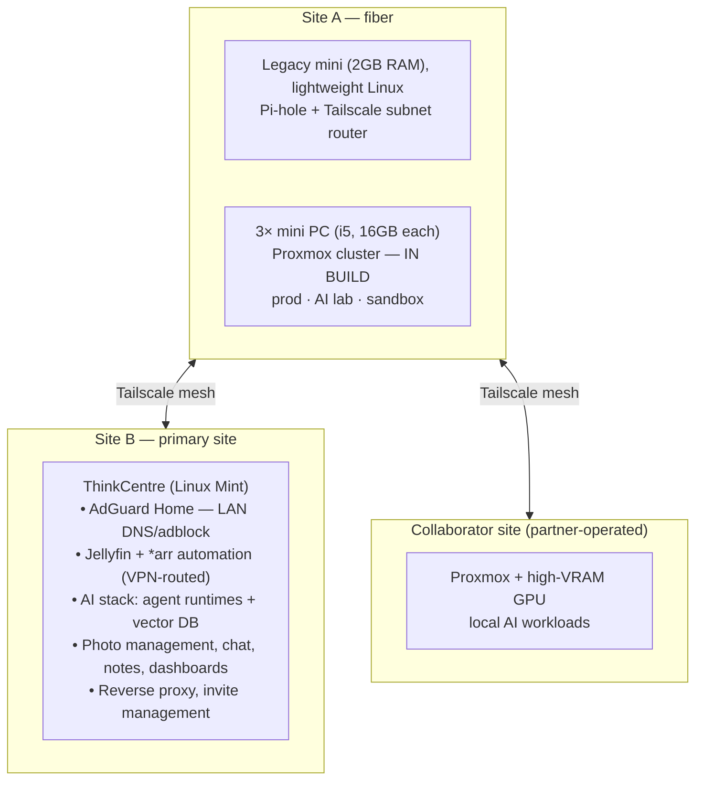

# Matts-Multisite-Homelab
Distributed Multisite Homelab. Using legacy hardware 

A self-taught, multi-site homelab connected over a Tailscale mesh network. The goal of this repository is complete reproducibility — every configuration that can live in Git, lives in Git.

Before contributing or cloning, please read `SECURITY.md` to understand what is deliberately redacted.

## 🌍 Infrastructure Overview

The lab is distributed across three physical locations:

- **Site B (Primary Site):** A Linux Mint ThinkCentre running 25+ Docker containers. This handles media automation, DNS, a local AI stack, and core self-hosted apps.
- **Site A (Fiber):** A 3-node Proxmox cluster (currently being built on i5 mini PCs) and a legacy mini PC acting as a lightweight Pi-hole and Tailscale subnet router.
- **Site C (Collaborator):** A partner-operated Proxmox node with a high-VRAM GPU dedicated to local AI workloads. (Note: Code for this node is not managed in this repo.)

## Architecture Diagram

## 🚀 What's Running

The compose stacks in this repo are exact reflections of the live environment.

- **Media Automation** (`docker/arrstack/`): Jellyfin, Radarr, Sonarr, Lidarr, Bazarr, and Seerr on a custom Docker network with static IPs. Prowlarr and qBittorrent sit behind a Gluetun VPN kill-switch (auto-restarted by Deunhealth if the tunnel drops).
- **Network & Security:** Tailscale (mesh routing), AdGuard Home (DNS/adblock), and Nginx Proxy Manager (reverse proxy).
- **AI Stack** (`docker/ai-stack/`): Containerized agent runtimes and vector databases.
- **Core Services:** CasaOS suite, photo management, private chat, notes, and dashboards.
- **System Tools:** rclone, RustDesk, SSH, and Samba.

## 📂 Repository Map

- 📁 `ansible/` — Playbooks for base configuration and services (uses placeholder IPs, validate on a VM before running).
- 📁 `docker/` — Live Docker Compose stacks for media, networking, dashboards, AI, and apps.
- 📁 `docs/` — Deep dives into architecture, node roles, Tailscale design, and rebuild guides.
- 📁 `proxmox/` — Cluster setup and template notes (currently a work-in-progress).
- 📁 `scripts/` — First-boot bootstrap scripts.
- 📄 `SECURITY.md` — Redaction policy and secrets management.

## 🛠️ The Rebuild Promise

If a server dies today, this repository brings it back tomorrow.

Ansible playbooks handle the base configuration, and the Docker directories contain the live Compose configs. Note: The Proxmox cluster is currently under construction, so files in `proxmox/` represent the build plan, not a finished deployment.

## 🧰 Built With

- **Core:** Proxmox VE • Tailscale • Docker • Ansible • CasaOS
- **Network:** Nginx Proxy Manager • Pi-hole • AdGuard Home
- **Media:** Jellyfin • *arr Stack • qBittorrent • Gluetun
